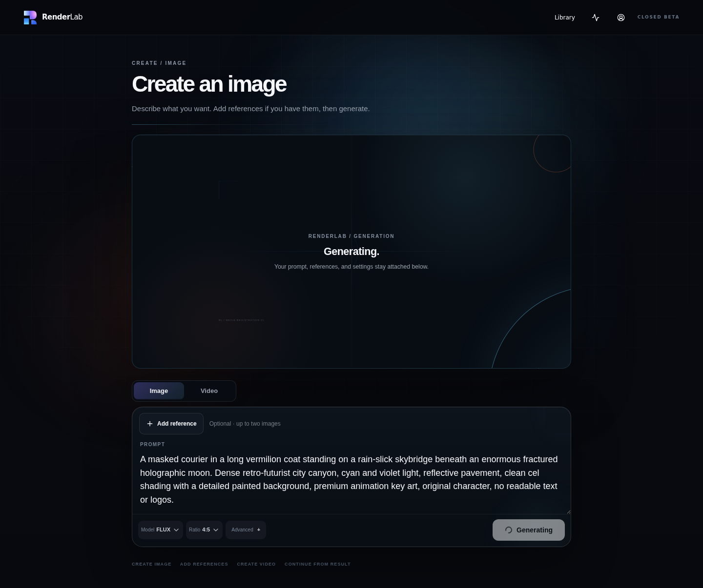
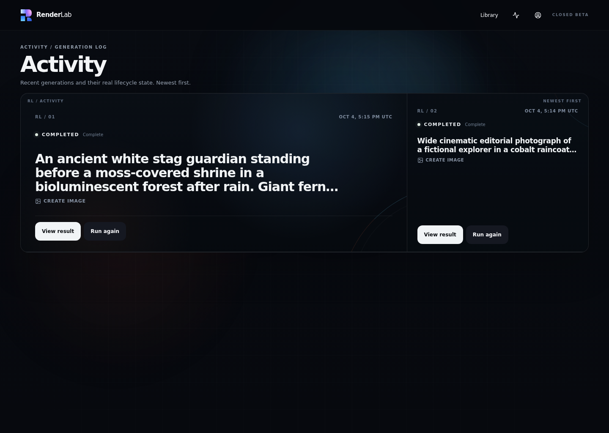
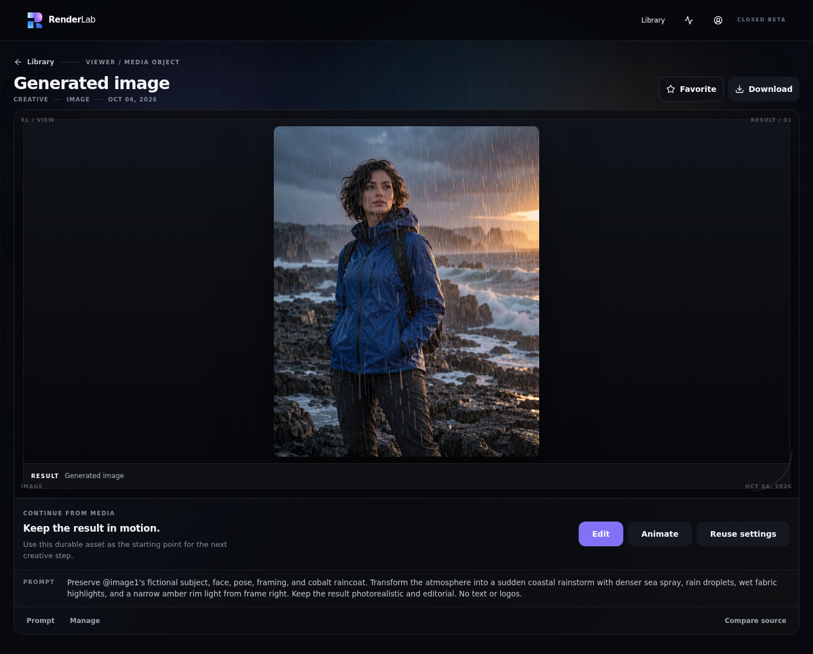
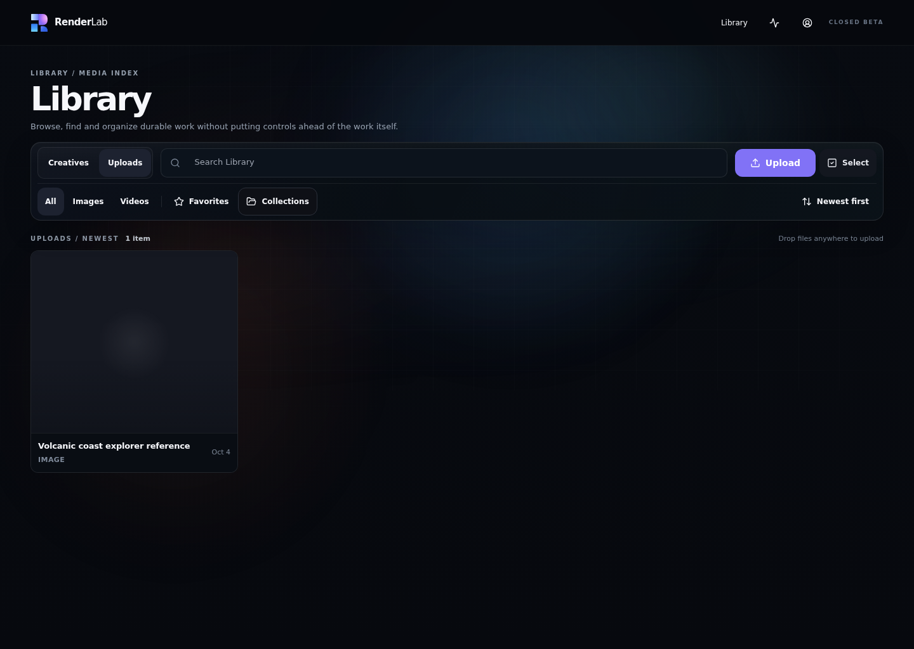
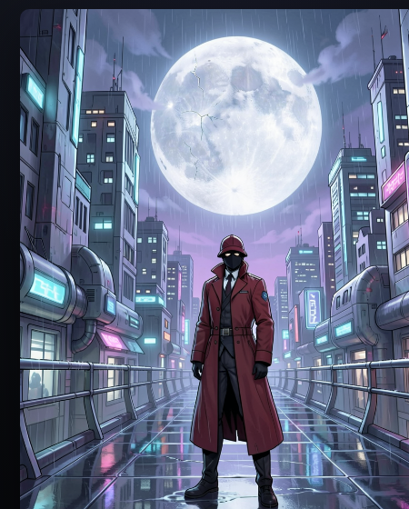
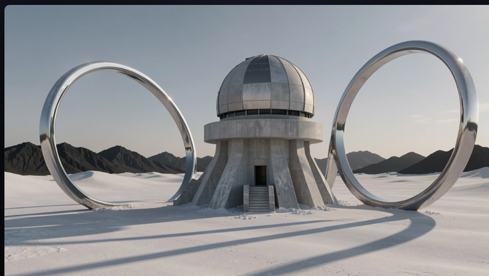
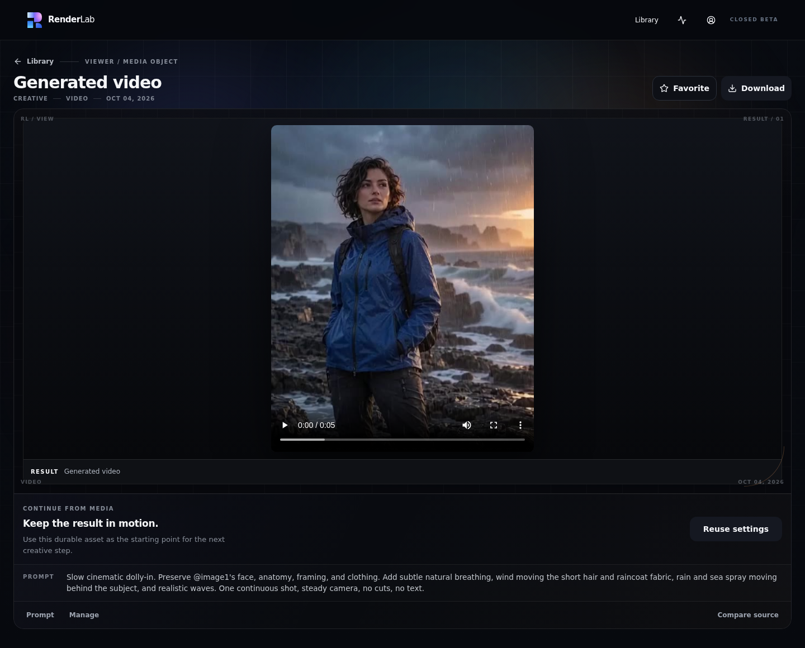
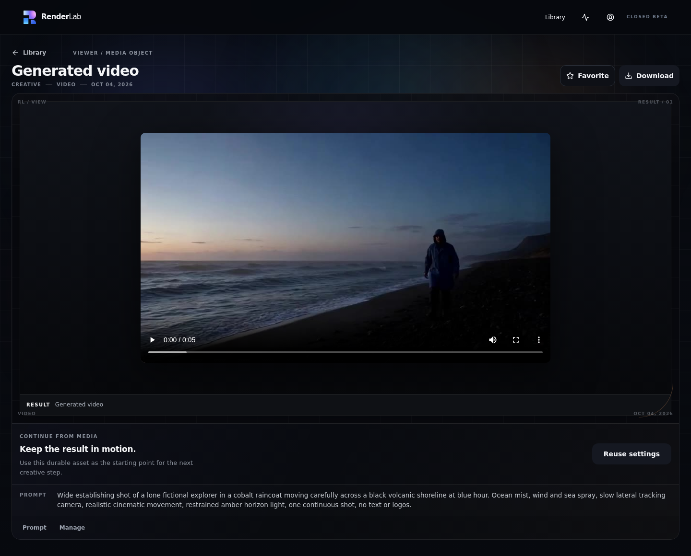
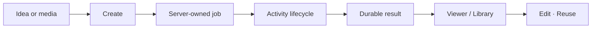
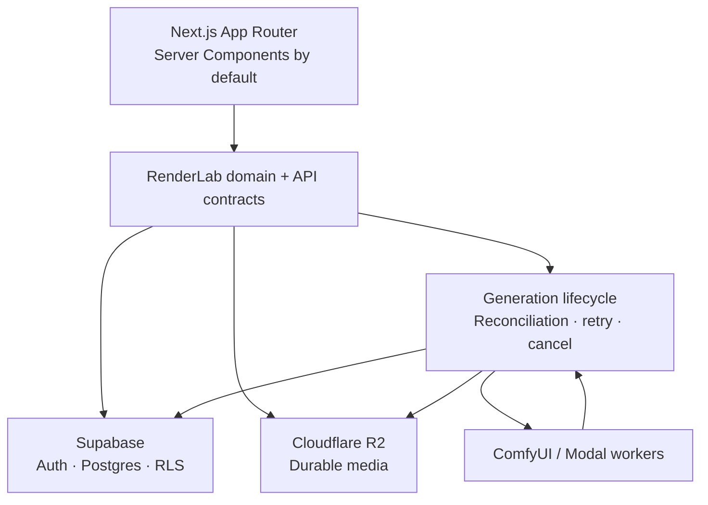

<p align="center">
  
</p>

> **Current scope:** The web workspace focuses on FIBO image creation and editing. Earlier releases supported additional models and media operations; historical captures are not current feature promises.

<h1 align="center">RenderLab</h1>

<p align="center">
  <strong>An invite-only AI media workspace for durable FIBO image creation and editing, built with Next.js, Supabase, R2 and Modal/ComfyUI.</strong>
</p>

<p align="center">
  Create, edit, organize, and continue from generated media while RenderLab handles workers, job state, storage, retries, and provider complexity.
</p>

<p align="center">
  <a href="https://renderlab.faresuniform.uk"><strong>Live product</strong></a>
  · <a href="docs/STATUS.md">Status</a>
  · <a href="docs/architecture/PRODUCT_CAPABILITIES.md">Capabilities</a>
  · <a href="SECURITY.md">Security</a>
  · <a href="LICENSE">License</a>
</p>

<p align="center">
  <a href="https://github.com/faresmohamed260/renderlab/actions/workflows/engineering-quality.yml"></a>
  
  
  
</p>

> **Access:** RenderLab is a closed-beta, invitation-only product. The public landing page is available; private workspace access requires authorization.

## What RenderLab is

RenderLab is the product layer between a creator and a cloud-hosted generation stack. Users work with understandable operations—generate an image, edit with references, organize results, and continue from an existing asset—while RenderLab owns provider routing, job state, durable persistence, retries, cancellation, and authorization.

### Why RenderLab

- **Durable creative lifecycle.** Accepted work is durably dispatched without the initiating browser staying open. In the current beta, a finished job can require the owner's next Create, Activity, Library or blocked-submit interaction to settle and publish its output.
- **Provider complexity stays behind product contracts.** ComfyUI graphs, worker identifiers, storage keys, and backend routing are not exposed as the user experience.
- **Media stays actionable.** A finished asset remains connected to prompt/provenance context and compatible next steps such as edit or reuse.

## Capability status — Now / Next / Historical

| **Now: supported in the closed beta** | **Next: planned, not available** | **Historical: retired from new submissions** |
| --- | --- | --- |
| FIBO image creation, reference editing and source-preserving masked editing; owner-scoped Library, Viewer and Activity. | Additional image models; upscale, face swap and background removal; video and audio after independent capability, cost and release qualification. | Earlier FLUX, Qwen and REDGraft LTX providers, and the old Video, Animate and Upscale submission paths. Historical saved media and verification captures can still be viewed. |

**Video is planned again, not abandoned.** The earlier Video/Animate routes are retired, not current features. The [product charter](docs/PRODUCT_CHARTER.md) governs future direction; [current capabilities](docs/architecture/PRODUCT_CAPABILITIES.md) and the [production manifest](docs/production/current.json) govern what is real today. See the [technical claims and evidence sheet](docs/TECHNICAL_CLAIMS.md).

## Product surfaces

| Surface | Production role |
| --- | --- |
| **Create** | FIBO image generation and reference-backed editing, with contextual controls. |
| **Activity** | Truthful queued/running/persisting/terminal job state with retry, rerun, cancellation, and result access. |
| **Media Viewer** | Asset inspection, provenance, prompt context, download/favorite actions, and compatible continuation paths. |
| **Library** | Durable generated media and uploads with search, favorites, collections, ordering, rename, download, deletion, and reuse. |
| **Settings** | Profile, preferences, credentials, sessions, MFA, export, and account lifecycle. |
| **Admin** | Authorized closed-beta operations with recent-authentication boundaries where required. |

## Historical product captures

### Create



This capture shows an earlier Create release, not the current workspace.

<details>
<summary><strong>See Activity, Media Viewer, and Library</strong></summary>

### Activity



### Media Viewer



### Library



</details>

## Made with RenderLab

The examples below are **production-capture crops of real provider-backed RenderLab outputs**. The original QA fixture intentionally removed its generated R2 objects during cleanup, so these are not presented as retained raw model files.

### Cinematic editorial

<p align="center">
  
</p>

### Painterly fantasy

<p align="center">
  
</p>

### Stylized 3D

<p align="center">
  
</p>

<details>
<summary><strong>More production examples</strong></summary>

### Graphic sci-fi

<p align="center">
  
</p>

### Surreal architecture

<p align="center">
  
</p>

</details>

## Historical verification — retired Video and Animate paths

The following captures are **historical evidence only**: an older, bounded provider-backed verification produced an image-animation result and a text-to-video result, then cleaned up the generated R2 objects. They are **not current submit capabilities** or retained downloadable videos. Video is planned as a future media category under the product charter, but these old implementations are retired.

<details>
<summary><strong>View historical video/animation result captures</strong></summary>

### Image animation result



### Text-to-video result



</details>

## How the creative lifecycle works



Accepted jobs have **browser-independent durable dispatch and outbox recovery**. For the current beta, reconciliation and idempotent media finalization may occur when the **owner returns** to Create, Library or Activity, or attempts another submit while admission is occupied. A user who never returns has **no guaranteed app-side scheduled settlement**; this known retention risk is accepted for the small beta. [Owner-settlement implementation](src/server/generation/owner-generation-settlement.ts) · [hosted return proof](https://github.com/faresmohamed260/renderlab/actions/runs/45099617648).

## Architecture



RenderLab keeps schema ownership, storage prefixes, orchestration, authorization, and product contracts explicitly separated from underlying shared infrastructure. Start with the [two-page backend architecture overview](docs/architecture/BACKEND_ARCHITECTURE_OVERVIEW.md), then read [Infrastructure](docs/architecture/INFRASTRUCTURE.md) and [Frontend Architecture](docs/architecture/FRONTEND_ARCHITECTURE.md) for the deeper contracts.

## Security and reliability

| Concern | RenderLab approach |
| --- | --- |
| **Authorization** | Supabase Auth and application-level owner checks; RLS applies to scoped clients, while privileged service-role DB calls require explicit owner filtering. |
| **Privileged account actions** | MFA/session controls and recent-authentication boundaries for sensitive operations. |
| **Media delivery** | Server-owned storage access and presigned delivery/upload boundaries. |
| **Long-running generation** | Browser-independent durable dispatch; bounded owner-return reconciliation with retry/cancellation. |
| **Finalization** | Idempotent persistence and explicit terminal-state handling. |
| **Failures** | Sanitized user-facing failures while operational detail remains server-side. |
| **Data lifecycle** | Account export/deletion and fixture cleanup workflows. |
| **Security reporting** | Private reporting guidance in [SECURITY.md](SECURITY.md). |

## Technology

- **Application:** Next.js 16, React 19, TypeScript 7, Tailwind CSS 4
- **Interface:** Radix/shadcn-derived primitives, Motion for React, Lucide
- **Data and identity:** Supabase Auth, PostgreSQL, Row Level Security
- **Media:** Cloudflare R2
- **Generation:** one qualified production FIBO image-worker route behind the private Modal/ComfyUI gateway; historical multi-worker/failover logic is not a live FIBO standby pair
- **Quality:** Oxlint, TypeScript, Node test runner, Playwright, repository-specific contract verifiers
- **Delivery:** Vercel with guarded production qualification

**Versioned generation API contract:** see [OpenAPI 3.1 source, status/error taxonomy and compatibility policy](docs/architecture/API_CONTRACT.md), generated from the executable FIBO request and response schemas. The API remains invite-only and not a supported public integration.

## Local development

**One-command offline backend walkthrough:** `npm run demo:backend` (after `npm ci`); see the [seven-scenario demo guide](docs/operations/LOCAL_BACKEND_DEMO.md). No credentials, Docker, GPU or network required.


### Prerequisites

- Node.js **24.x** (see `.nvmrc`)
- npm **11.x** (`packageManager` remains pinned to npm 11.6.2)
- Git on native Windows or Linux/WSL2. macOS is expected-compatible but is not an ENT-008 verified exit platform.

Verify the active toolchain before installing dependencies:

```bash
npm run doctor
npm run verify:text-policy
npm ci --no-audit --no-fund
```

The repository's ordinary lint/type/unit/static/build path is intentionally **secret-free**. You do not need a real `.env.local`, Supabase/R2/Vercel/Resend/Modal credentials, or provider access to run it. `.env.example` documents supported runtime variable names only; create `.env.local` when a specifically authorized configured/shared-resource workflow requires it.

For local product development after the toolchain/install checks:

```bash
npm run dev
```

`.gitattributes` makes repository-owned text LF on both native Windows and Linux/WSL, independent of a developer's global `core.autocrlf` setting. If `npm run verify:text-policy` reports CRLF in an existing checkout, use a fresh checkout after the policy is present rather than mass-editing file contents.

### Secret-free quality checks

```bash
npm run doctor
npm run verify:text-policy
npm run lint
npm run typecheck
npm run test:unit
npm run verify:engineering-quality
npm run verify:modal-project-ownership
npm run verify:ui-purity
npm run build
```

The Developer Portability workflow runs that same path from fresh Linux and Windows checkouts. Feature-specific Playwright, integration, account lifecycle, generation, media, cleanup, provider-backed, and production-verification workflows under `.github/workflows` remain separate and may require protected credentials, run-owned fixtures, cleanup, and explicit authorization.

### Unit coverage visibility

Run the existing Node unit suite with all-source coverage, then verify the report boundary:

```bash
npm run test:unit:coverage
npm run verify:unit-coverage
```

Coverage is written to the ignored `coverage/` directory as a text summary, `coverage-summary.json`, and `lcov.info`. The denominator is every tracked product-source `.ts`/`.tsx` file under `src/**`, including files the unit process never imports; declaration-only `.d.ts` files are excluded. The verifier fails closed if eligible files disappear, metrics are malformed, or retained paths escape the repository boundary.

GitHub's secret-free **Unit Coverage** workflow runs the same Node 24 path, publishes the unit totals in the job summary, and retains only the JSON summary plus LCOV as a bounded artifact. These percentages describe the Node unit suite only. A low unit-coverage number does not mean RenderLab lacks browser, configured integration, shared-resource, provider-backed, release-candidate, or production acceptance; those remain independent required verification layers and must not be weakened to improve the unit percentage.

## Repository map

| Path | Owns |
| --- | --- |
| `src/app` | Routes and server/client boundaries |
| `src/features` | Product features and domain-facing UI |
| `src/components/ui` | Approved shared UI primitives |
| `src/server` | Server-owned domain, generation, storage, account, and operational logic |
| `workers` | Generation adapters and worker entry points |
| `supabase` | RenderLab-owned schema migrations |
| `scripts` | Verification, maintenance, and operational tooling |
| `tests` | Unit, integration, and browser contracts |
| `docs/architecture` | Architecture, infrastructure, security, and capability contracts |
| `docs/ui` | UI decisions, system, screens, and migration state |

## Documentation

Public/product documentation starts with:

1. [Engineering practices and verification evidence](docs/ENGINEERING_PRACTICES.md)
2. [Product charter and planned scope](docs/PRODUCT_CHARTER.md)
3. [Evidence-linked technical claims](docs/TECHNICAL_CLAIMS.md)
4. [Current public status](docs/STATUS.md)
5. [Product capabilities](docs/architecture/PRODUCT_CAPABILITIES.md)
6. [Backend architecture overview](docs/architecture/BACKEND_ARCHITECTURE_OVERVIEW.md)
7. [Private generation API contract (OpenAPI 3.1)](docs/architecture/API_CONTRACT.md)
8. [Frontend architecture](docs/architecture/FRONTEND_ARCHITECTURE.md)
9. [Infrastructure and security boundaries](docs/architecture/INFRASTRUCTURE.md)
10. [Product/UI foundation](docs/ui/UI_MIGRATION.md)
11. [Durable UI decisions](docs/ui/UI_DECISIONS.md)
12. [Visual north star](docs/ui/VISUAL_NORTH_STAR.md)
13. [Security reporting](SECURITY.md)
14. [Contribution policy](CONTRIBUTING.md)
15. [Release notes and production history](CHANGELOG.md)

Maintainer/agent handoff entry points and execution history remain repository-internal navigation rather than part of this public documentation path.

## Known limitations

- RenderLab is closed beta; private workspace access is not public self-service.
- There is no supported public API or community plugin contract yet.
- Provider-backed generation depends on configured worker/provider availability and admission controls.
- Some model/workflow routes remain capability-gated until production ownership and readiness are verified.
- The retained artistic QA fixture cleaned its generated R2 objects, so the current public gallery uses verified production-capture crops rather than raw downloadable model outputs.
- The project currently uses exact production commit qualification rather than a public semantic-release stream.

## Current direction — backend first

RenderLab remains a personal/friends closed beta and an AI Engineer portfolio project. Its **backend-first** policy and explicit [exit gate](docs/PRODUCT_CHARTER.md#backend-first-policy-and-exit-gate) remain in force. The [P0 baseline contract](docs/architecture/BACKEND_PROFESSIONAL_BASELINE_P0_CONTRACT.md) records the original five-unit scope; [technical claims](docs/TECHNICAL_CLAIMS.md) and [current production record](docs/production/current.json) distinguish accepted code, verified evidence, and what actually shipped.

The offline backend demo and private API contract are reviewable. A typed [provider-adapter boundary](docs/architecture/PROVIDER_ADAPTER_BOUNDARY.md) and its fake-utility conformance proof are merged but **unwired**; they enable no new provider route or user-facing operation. New models, upscale, face swap, background removal, video and audio still require independent qualification and an owner-authorized release. Frontend changes remain on hold until the backend exit gate is met and the owner expressly resumes that phase.

See [STATUS.md](docs/STATUS.md) for deployed capability and [TECHNICAL_CLAIMS.md](docs/TECHNICAL_CLAIMS.md) for independently checkable statements. Execution history remains historical evidence under repository governance.

## Contributing, security, and license

RenderLab is source-visible for portfolio/evaluation purposes and is **not currently an open-source community project**. See [CONTRIBUTING.md](CONTRIBUTING.md) before proposing changes, [SECURITY.md](SECURITY.md) for vulnerability reporting, and [LICENSE](LICENSE) for usage rights.

---

<p align="center">
  <strong>Render what you imagine. Keep the thread alive.</strong>
</p>
