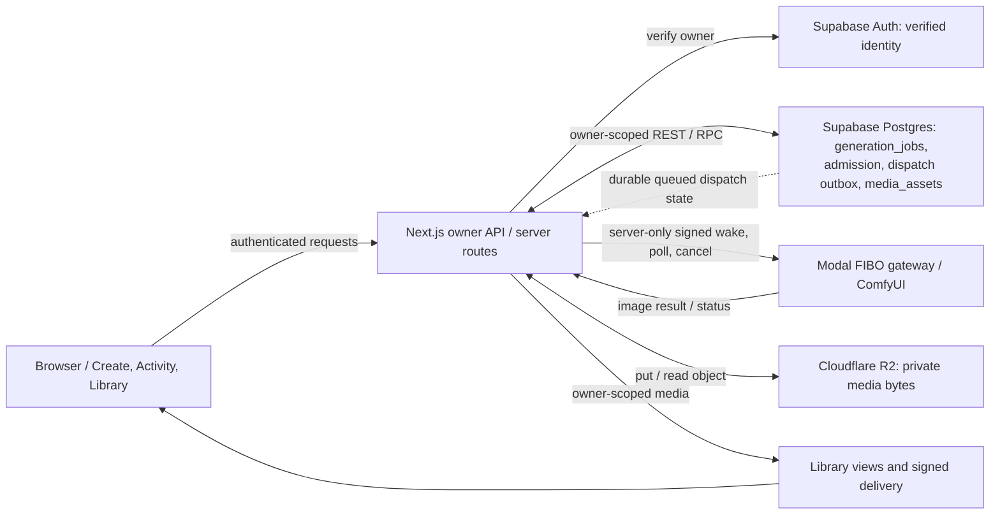

# Backend architecture overview (current closed beta)

**Scope:** RenderLab's current FIBO image generation and editing only; not a general video, audio or multi-model platform. **Authority:** [technical claims](../TECHNICAL_CLAIMS.md), [capabilities](PRODUCT_CAPABILITIES.md), [P0 state specification](P0_04_GENERATION_STATE_MACHINE_SPEC.md), [production record](../production/current.json). This is a concise source-based map, not a claim that the latest merged code is deployed.

**Current production update (2026-11-23):** [Atomic P0-07 FIBO release proof](../audits/PHASE3_P007_ATOMIC_PRODUCTION_SMOKE_VERIFICATION_2026-11-23.md) is live at source `b548fe40ac274bb4d5bc6d2674ce7bfac556bfcf`. The new service-only 0031 RPC atomically finalizes a converted FIBO job and releases its bound reservation; this does not guarantee unattended finalization for owners who never return or cover generic SQL writers. The original diagrams below remain conceptual; detailed historical P0-04/06 limitations describe the pre-0031 checkpoint.

## 1. Context and containers



The browser **does not** receive database service-role credentials, worker credentials or direct access to arbitrary R2 objects. Next.js verifies current account admission, validates requests, creates/adopts jobs and admission reservations, and serves owner-filtered API routes. Supabase Auth authenticates; Postgres stores durable jobs, reserved slots, the dispatch outbox and media metadata. The Modal FIBO gateway handles **only the configured FIBO image worker**; app-side finalization writes generated bytes to R2 and indexes their Library media rows. Historical Upscale/Video/Animate paths are retained for compatibility but cannot accept new submissions.

The [outbox SQL](../../supabase/migrations/0030_modal_generation_dispatch_outbox.sql) and [recovery migration](../../supabase/migrations/20261120022122_modal_dispatch_recovery.sql) make accepted dispatch browser-independent. **They do not guarantee unattended finalization:** a browser that never returns may leave a finished provider result unsettled.

## 2. Accepted job to Library: one lifecycle

```mermaid
sequenceDiagram
    participant U as Browser
    participant API as Next.js owner API
    participant DB as Supabase/Postgres
    participant GPU as Modal FIBO gateway
    participant R2 as Private R2
    U->>API: POST /api/generation/jobs (owner session)
    API->>DB: Reserve slot; insert job + accept outbox
    API-->>U: HTTP 202 (queued job)
    API->>GPU: Server-owned outbox wake / dispatch
    GPU-->>API: Accepted provider call or ambiguous send
    Note over API,DB: Dispatch recovery preserves uncertainty; no blind duplicate
    U->>API: Poll / return to Create, Activity or Library
    API->>DB: Claim reconciliation / inspect current status
    API->>GPU: Signed provider status / fetch result
    GPU-->>API: Pending / ready PNG / terminal failure
    API->>DB: Status-conditional active -> persisting
    API->>R2: Store deterministic result + optional thumbnail
    API->>DB: Unique indexed media; terminal success; release reservation
    API-->>U: Current job and owner-visible Library asset
```

The **owner-return** path is bounded and best-effort: [settlement](../../src/server/generation/owner-generation-settlement.ts) invokes [reconciliation](../../src/server/generation/reconcile-generation.ts); the [native lifecycle](../../src/server/generation/native-generation.ts) handles provider and persistence; [admission](../../src/server/generation/generation-admission.ts) owns slot release. Replays reuse the indexed output when present. The [P0-06 status-CAS fix](../audits/P0_06_STATUS_CAS_FIX_RELEASE_PLAN_2026-11-23.md) guards stale generic job PATCHes. [P0-07 migration 0031 and app switch](../audits/PHASE3_P007_ATOMIC_PRODUCTION_SMOKE_VERIFICATION_2026-11-23.md) **now atomically commit a terminal job outcome and bound reservation release for the converted FIBO path**, with a real Postgres contention test and one successful hosted proof. It is **not a global SQL state transition trigger**, and other legacy/raw writers may still commit separate updates.

## 3. Eight-state transition summary

| State | Legal different-status successors | Notes |
| --- | --- | --- |
| `queued` | running, cancelling, cancelled, persisting, failed | Outbox acceptance may precede confirmed dispatch; ready result can arrive while queued |
| `preparing` | running, cancelling, persisting, failed | Historical compatibility state |
| `running` | cancelling, persisting, failed | Provider work; pending observations may stay running |
| `cancelling` | cancelled | Serialized cancellation; transient failure remains cancelling |
| `persisting` | succeeded, failed | One indexed output per job/output index; recovery can replay |
| `succeeded` / `failed` / `cancelled` | none | Terminal; read/release replay must not reopen or rewrite |

The [Unit 4 matrix](P0_04_GENERATION_STATE_MACHINE_SPEC.md) is normative for the observed policy; its [pure TS model](../../src/lib/capabilities/generation-job-state-machine.ts) tests all 64 state pairs. SQL CHECK constraints validate **values**, not the full transition graph. P0-06 adds expected-status database updates and P0-07 adds **scoped atomic terminalization**; neither is a global SQL state-machine trigger.

## 4. Trust boundaries, recovery and extension seams

**Trust boundaries:** server-verified session and current invitation/admission → owner-scoped Next.js routes → privileged Supabase REST/RPC (**service-role bypasses RLS, so owner filters are mandatory**) → server-only Modal authentication and signed object delivery. Admin MFA, internal maintenance secrets, error redaction and cross-owner negative cases are specified in [P0-03 trust-boundary matrix](P0_03_TRUST_BOUNDARIES_AND_OWNER_ISOLATION_CONTRACT.md). Never treat an arbitrary job ID, caller-provided owner ID, provider handle or storage key as authority.

| Failure | Existing recovery / limitation |
| --- | --- |
| Tab closed after HTTP 202 | Durable dispatch continues; finalization usually resumes upon owner return, not continuously |
| Wake lost / send ambiguous | Persisted outbox and idempotent dispatch recovery; do not infer second accepted call |
| Modal pending, 409 process exit, unavailable or expired result | Pending stays active; explicit `FIBO_PROCESS_EXITED` maps to failed; unknown result uses bounded stale policy |
| Missing dispatch / delayed cancellation | 15-minute missing-dispatch grace; cancellation has status+token CAS; settled terminal cannot be rewritten by stale generic PATCH |
| R2/DB commit or response loss | Deterministic object/asset ID and unique output index permit bounded recovery; not a guarantee of a single R2 PUT |
| Terminal job still holding admission | Converted FIBO terminal writers use **one 0031 RPC transaction** to terminalize and release; raw/legacy writers still can leave held admission, so retain independent aggregate monitoring and reconciliation |

**Extensibility seams, not shipped promises:** [request validation and operation types](../../src/lib/api/generation-contract.ts), [worker selection/policy](../../src/server/generation/worker-fleet.ts), [submission/admission](../../src/server/generation/submit-generation.ts), [provider lifecycle](../../src/server/generation/native-generation.ts) and [durable media](../../src/server/media/media-assets.ts). New providers/modalities need new reviewed contracts, routing, safety checks, verification and a release; FIBO is the only current new-generation route.

**Local checks (no provider calls):** `npm ci`; `npm run typecheck`; `npm run lint`; `npm run build`; `npm run test:unit:coverage`; `npm run verify:unit-coverage`; `npm run verify:engineering-quality`; `npm run verify:docs-governance`; `npm run verify:ui-purity`; `node tests/helpers/verify-generation-critical-path-determinism.mjs` (20 independent offline test processes). Hosted tests, schema migrations, provider work and production deployment require their own explicit gates in the [release runbook](../operations/PRODUCTION_RELEASE_RUNBOOK.md).
