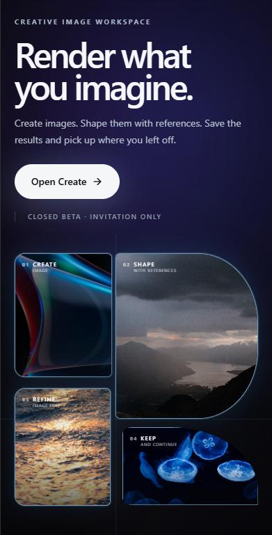
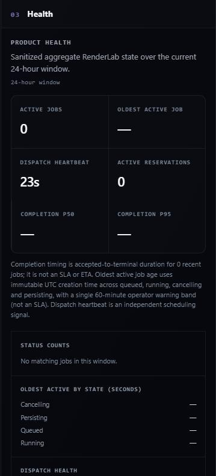
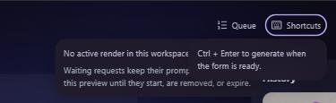
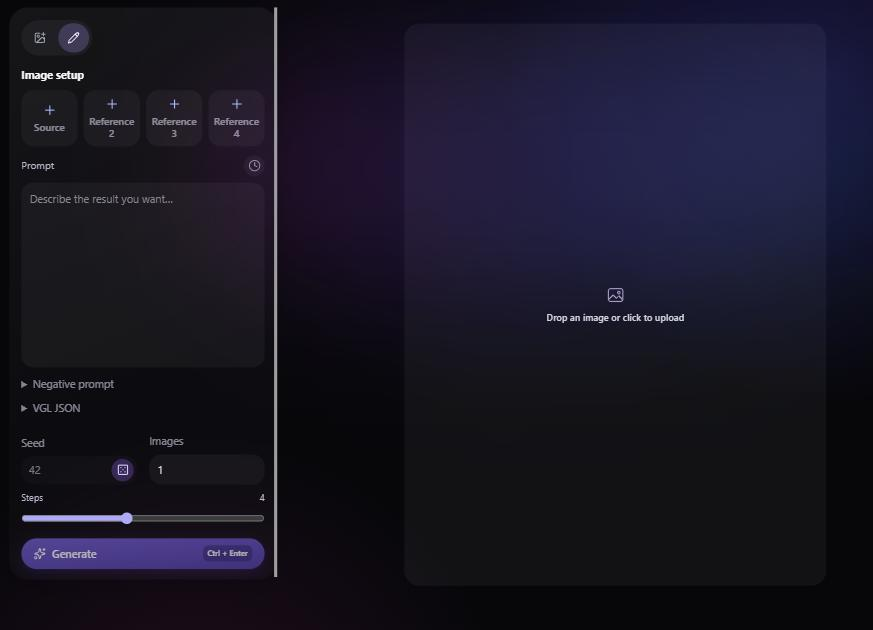
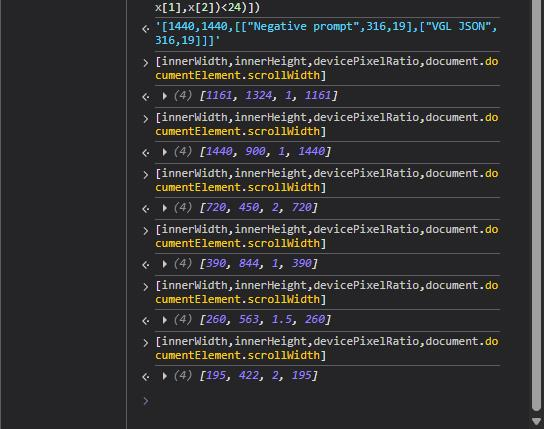
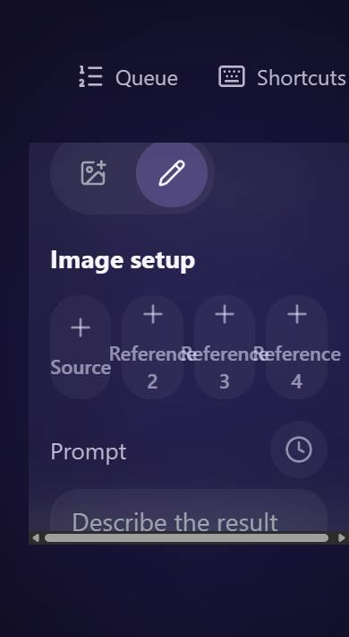
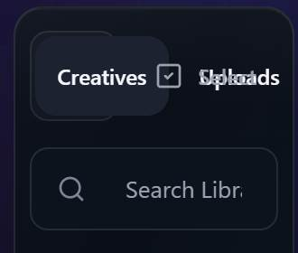

# Frontend production QA pass — 2026-11-24

**Status: baseline touch-target geometry and actual 200% browser-zoom route sampling completed on the third sitting; earlier interruptions and confirmed defects retained below.** FE-01 was reproduced live. This is evidence, not blanket frontend acceptance or accessibility conformance. The owner approved the integration-first Phase 5 contract (PR #677); remaining coverage limitations and post-release acceptance remain explicitly open. No UI redesign or runtime fix is authorized by this audit.

## Scope and verified starting point

- Operator: worker 1, production QA, existing signed-in admin session on WANDA (Brave/Chromium DevTools responsive emulation). Production custom domain `renderlab.faresuniform.uk`.
- Application SHA `aeb43cb508297e22c52d87de4df747cbd7c8516a`; Vercel deployment `dpl_7Q8CbxmgWJW5qmizzHtBXcoNP8HY`, custom-domain cutover `2026-11-24T05:56:36.063Z`. [Canonical record](../production/current.json), [successful Production Documentation Sync #45338450898](https://github.com/faresmohamed260/renderlab/actions/runs/45338450898). The deployment detail page visible on WANDA also identified the READY current Production deployment and the matching source.
- Repository main at preflight: `4216626a5acff9b82131a64aa1d4f28f628ccfcb`. Quality, governance, coverage, portability and CodeQL workflows were successful on that main. Nine PRs were open initially; no worker ready-to-merge comments were observed on the subsequently opened #665–667 at the time of the queue recheck.
- Read-only production walkthrough authorized by the head engineer after the owner's backend-first gate decision. Integration Mode only; no change to APPROVED/LOCKED surfaces. [Technical claims](../TECHNICAL_CLAIMS.md), [UI System](../ui/UI_SYSTEM.md), [Screen Registry](../ui/SCREEN_REGISTRY.md), [release runbook](../operations/PRODUCTION_RELEASE_RUNBOOK.md).
- No generation, retry, upload, download, favorite, settings save, invitation, MFA submission/removal, account change, provider change, migration, or deployment was initiated. Normal authenticated navigations/reads can exercise existing owner-return behavior; this is not a database zero-write attestation. No verification-generation allowance was spent. No credential, raw response body, or user-identifying screenshot is committed.

## Method and coverage ledger

At baseline, DevTools Responsive was set to 390 × 844 and 1440 × 900 CSS px. The DevTools console verified `[innerWidth, document.documentElement.scrollWidth, innerHeight, devicePixelRatio]` = `[390,390,844,2]` on Landing and `[1440,1440,900,2]` on Admin. Other routes were visually inspected at those configured widths; their per-route numeric overflow assertions remain unmeasured. Desktop captures were fit-to-window previews (not an assertion about physical screenshot width). Preserved console logs showed no errors or warnings across the initial navigation pass, including no visible React hydration error; the DevTools Issues counter was not investigated.

| Surface | 1440 × 900 baseline | 390 × 844 baseline | Keyboard / state evidence and limitations |
| --- | --- | --- | --- |
| Landing | Hero and media matrix rendered | Hero and media matrix stacked; no obvious page-wide overflow | 1440 reduced-motion: Tab reached Open Create with visible focus, Shift+Tab reached avatar and navigation, Enter opened navigation, Tab focused Home/Create in order, Escape closed and restored trigger focus; Enter on Create navigated. Remaining sections and 390 keyboard parity not fully traversed. |
| Create | Composer, preview and History rendered; history thumbnails initially placeholders then loaded | Composer and four reference tiles rendered; nested form scroll present; Generate below initial visible scroll area | 1440 keyboard: avatar → Queue → Shortcuts; visible focus. Empty queue rendered. Queue and Shortcuts coexist and ignore Escape (FQA-01). 390 clipping observed on resize with both open. Fresh 390 keyboard reproduction, full form scroll/target metrics and error states not completed. No submission. |
| Library | Four-column grid, search/filter toolbar, historical video asset; initial image placeholders | Two-column grid and horizontally clipped/scrolling toolbar segment | Populated and initial loading observed; historical video is not a new generation feature. Toolbar scroll and focus visibility need verification; empty search, menu Escape, and failure state untested. |
| Media Viewer | Existing completed image loaded; Favorite, Download, Edit and Reuse settings visible | Same existing image initially placeholder, then rendered; continuation actions visible | Read-only View result from Activity at both widths. No action that changes data or downloads was invoked. Viewer focus order and loading failure not tested. FE-01 continuation actions tested during the resumed pass (see addendum). |
| Activity | Job matrix/history list rendered | Stacked history cards rendered | Existing completed/cancelled records, result links, and truthful lifecycle labels observed. No Run again/Cancel invocation. Full keyboard, empty/error states not tested. |
| Settings overview | Account, Access, Security and start of Sessions rendered | Account and Access rendered | Lower Sessions/preferences/data/admin sections not fully traversed. |
| Settings profile | Edit profile rendered | Edit profile rendered | Existing display identity and avatar eventually loaded; no edit/save/remove. |
| Settings preferences | Create defaults form rendered | Create defaults form rendered | Default aspect ratio and save/reset controls visible. No preference change or save; dropdown keyboard/Escape not tested. |
| Settings email and password | Both redirected to authenticator step-up screen | Both redirected to authenticator step-up screen | Code input auto-focused with visible outline; disabled Verify when empty. Post-challenge forms blocked by fresh step-up requirement; no code entered. |
| Settings MFA | Verified authenticator management rendered | Verified authenticator management rendered | No removal, enrollment or security change. Dialog/focus behavior not tested. |
| Admin | Access, invitation, admitted account, generation and diagnostic portions observed | Access and Health inspected; no pending invitations | Health showed zero active jobs/reservations; dispatch heartbeat, no timing sample and no matching jobs; GET shape verified below. Full diagnostic filters, keyboard, error and all lower content not fully exercised. |

Reduced motion: DevTools Rendering emulated `prefers-reduced-motion: reduce`; console returned `[true,1440,1440]` for preference/viewport/scroll width on Admin. Landing and Create keyboard interactions were exercised under this emulation. No temporal trace or exhaustive route-by-route motion inspection was captured. Responsive 390 was subsequently selected with the reduced-motion setting active; independent 390 motion tests were interrupted.

200% zoom: Brave's zoom popup explicitly showed 200%. DevTools device emulation still returned `[1440,2,1440,1440]` for innerWidth/DPR/visualViewport.width/documentElement.scrollWidth, so its fixed CSS viewport neutralized the intended reflow test. **Do not count this as a passed 200% zoom check.** Real browser zoom/reflow at each requested baseline and effective narrow-width behavior remain unverified. Preemption occurred before restoration of the QA tab's emulation/zoom; those local browser settings do not change production.

## Findings

Severity is the operator's QA triage, not a security rating: medium = materially affects an interaction or operator visibility; low = localized UX concern or candidate needing confirmation; info = positive evidence/coverage limitation.

| ID | Surface | Viewport | Severity | Description | Evidence |
| --- | --- | --- | --- | --- | --- |
| FQA-01 | Create | 1440 and 390 | Medium — confirmed | Queue and Shortcuts disclosures can remain open simultaneously, overlap, and do not dismiss on Escape. At 1440, Tab to Queue, Enter, Escape, Tab to Shortcuts, Enter, Escape left both visible; focused Shortcuts remained outlined. Resizing that state to 390 clipped the left side of the Queue copy outside the page. A fresh 390 keyboard reproduction remains to be done. Use maintained dismissal/focus semantics and responsive placement; no redesign. | [1440 screenshot after Escape](frontend-qa-2026-11-24/create-escape-1440.jpg); 390 resize visually observed. |
| FQA-02 | Admin Health | Both | Medium — confirmed | New `generationObservability` aggregates are returned by production API but not rendered by deployed Admin UI. Operators cannot see dispatch-latency and terminal-held metrics/availability in this view. Existing metrics are not missing: active jobs, oldest age, dispatch heartbeat, active reservations, completion p50/p95, state/operation/error counts and other existing panels are wired. Integrate new aggregates without replacing existing approved Health composition or presenting unavailable values as zero. | Live authenticated GET `/api/admin/health` console read of keys only: `['available','dispatchLatency','terminalHeld']`. [API handler](https://github.com/faresmohamed260/renderlab/blob/aeb43cb508297e22c52d87de4df747cbd7c8516a/src/app/api/admin/health/route.ts), [server aggregate](https://github.com/faresmohamed260/renderlab/blob/aeb43cb508297e22c52d87de4df747cbd7c8516a/src/server/admin/admin-operations.ts#L397-L431), [deployed UI](https://github.com/faresmohamed260/renderlab/blob/aeb43cb508297e22c52d87de4df747cbd7c8516a/src/features/admin/admin-operations.tsx#L253-L331), [390 Health screenshot](frontend-qa-2026-11-24/admin-health-390.jpg). |
| FQA-03 | Library | 390 | Low — candidate | Filter strip shows only part of Collections at initial horizontal position, and sort is beyond the visible segment. This may be intentional overflow within the toolbar rather than document overflow. Verify touch/keyboard access, scroll affordance and focus visibility before treating as a defect. | Visual mobile Library walkthrough, no horizontal scroll interaction completed. |
| FQA-04 | Create | 390 | Low — candidate | Composer's internal scrolling places Generate below the initial visible area; ensure it is reachable by touch and keyboard and not clipped by fixed viewport/safe-area geometry. Not a demonstrated unreachable control. | Visual mobile Create walkthrough; actual scroll-to-Generate check incomplete. |
| FQA-05 | Create / shared shell | 1440 | Low — observation | Keyboard focus moved from rightmost profile/avatar to Queue then Shortcuts, rather than visual left-to-right order Queue → Shortcuts → avatar. Focus indicators were visible. Check reading/focus order against approved shell semantics; no keyboard trap established. | Actual Tab sequence after keyboard navigation into Create. |
| FQA-06 | Activity / Admin / shared chrome | Both | Low — candidate | Small muted uppercase metadata and secondary text appeared low-contrast against dark surfaces, particularly timestamps and diagnostic labels. Disabled controls also appear subdued. No measured ratio or WCAG failure asserted; sample actual composited colors in follow-up and distinguish disabled controls. | Visual inspection, contrast computation not completed. |
| FQA-07 | Landing / Library / Activity / Settings / Create | Both | Info | Observed copy was consistent with closed-beta image creation, references, editing, storage and lifecycle claims. Library's Videos filter and historical video asset are read-only historical media, not evidence of video submission. No unavailable feature was advertised in the inspected Landing hero or visible Create controls. This was not exhaustive copy inventory. | [Claims](../TECHNICAL_CLAIMS.md), [Landing screenshot](frontend-qa-2026-11-24/landing-390.jpg), baseline navigation observations. |
| FQA-08 | Console | Both | Info | No console errors/warnings or hydration error observed during initial full-route navigation log. DevTools Issues badge appeared on Create; not inspected. Client transitions sampled only; not a whole-app guarantee. | Preserved DevTools console log (navigation info only, plus operator read-only expressions). |
| FQA-09 | Settings | Both | Info | Protected email/password destinations showed authenticator challenge; input focus ring visible. Post-step-up pages were not inspected to avoid a security-sensitive action. | Direct navigation to both routes at both widths; disabled Verify. |
| FQA-10 | Landing/shared navigation | 1440 | Info | Keyboard navigation opened menu, focused Home then Create, dismissed on Escape and restored trigger focus. Keyboard activation navigated to Create. | Direct Tab/Shift+Tab/Enter/Escape walkthrough under reduced-motion emulation. |
| FQA-11 | All | Both | Info — incomplete | WANDA returned `CONTROL_PREEMPTED` while attempting DOM touch-target measurement. Desktop interaction stopped immediately and was not retried within that pass. A separately authorized resumed pass reproduced FE-01, then again returned `CONTROL_PREEMPTED` during the attempted target measurement; desktop work stopped. | Tool response; remaining work listed below. |

## Sanitized screenshot evidence

The three images are cropped from actual live-site captures already made before preemption. The crops omit profile/avatar, account identifiers, prompt text and browser chrome. No screenshot was generated synthetically.

## Required completion before QA gate can close

1. Resume only with desktop control available and an explicitly identified live deployment. Reset local site zoom/device emulation as appropriate; confirm no conflicting production work.
2. Per-route numeric document overflow and nested-scroll checks at 1440 and 390; all Settings overview sections and post-step-up routes if separately authorized, Admin lower sections, and mobile toolbar/Generate reachability.
3. Keyboard-only complete tab order, focus visibility, focus return and Escape for each applicable menu/dialog/viewer at both widths; confirm FQA-01 independently at 390. Never activate data-changing actions.
4. Actual 200% browser zoom/reflow at both baseline sizes; use verified CSS width/DPR rather than DevTools fit-to-window scale as evidence. Reduced-motion temporal/interaction evidence at both widths, including Media Viewer and transitions.
5. Measure touch target geometry and spacing (not only icon glyphs) and contrast of actual composited foreground/background, including focus indicators. Use non-mutating filters to exercise empty states; use controlled test fixtures or read-only client-side fault simulation for loading/error states rather than disrupting live services. Do not create jobs or change account data.
6. Inspect DevTools Issues and recheck console/hydration on client transitions; complete copy audit of lower surfaces and all capability-dependent actions.
7. Record exact-head evidence and update this audit with completed coverage. Do not infer completion from a merged documentation-only partial record, or start Phase 5 on the basis of this report alone.

**Production unchanged by operator:** no release, migration, Modal action, secret modification, generation spend, or S.A.G.A. work. The initial pass is useful evidence for integration-first triage, not approval of the frontend phase.

## Resumed live QA — 2026-11-24 (FE-01)

The head engineer separately authorized resumption and a read-only FE-01 check. WANDA initially reported ready; the existing signed-in browser and production domain were used at the configured 1440 × 900 responsive viewport. No generation was submitted, no file uploaded, and no account or media record was deliberately modified. The existing completed QA-003 purple-cube image (November 19; Viewer prompt visibly nonempty) was opened through Activity → View result. The live Viewer labels the source continuation **Edit**, not “Use in Create”; its separate action is **Reuse settings**.

| ID | Surface | Viewport | Severity | Expected / observed | Evidence |
| --- | --- | --- | --- | --- | --- |
| FE-01a | Viewer → Create | 1440 | High — confirmed | Edit should carry the selected completed image into Create as source. The action navigated to editing mode, but after loading the Source tile remained an empty + and the preview still said “Drop an image or click to upload.” Prompt was empty. | [Settled Edit capture](frontend-qa-2026-11-24/fe01-edit.jpg). |
| FE-01b | Viewer → Create | 1440 | High — confirmed | Reuse settings should carry the saved recipe; the Viewer displayed a nonempty original prompt. After returning to the same Viewer and invoking Reuse settings, Create showed an empty prompt and apparent defaults: seed 42, images 1, steps 4. Source tile and preview also remained empty. The original seed/step values and dimensions were not independently read back, so numeric field mismatch is not asserted; prompt transfer is definitively missing. | [Settled Reuse settings capture](frontend-qa-2026-11-24/fe01-reuse.jpg). |

These observations corroborate [FE-01 in the frontend code audit](FRONTEND_CODE_AUDIT_2026-11-24.md), rather than inferring behavior from navigation alone. No Generate or Run again action was invoked. The screenshots are actual composer/preview crops without account identity, browser chrome, or unrelated user media.

**Resumption coverage ledger:** FE-01 source/prompt handoff is now confirmed broken at 1440. Touch target measurement was attempted after the FE-01 observations, but the tool returned `CONTROL_PREEMPTED: ready` before any result could be read; no retry was made. At the end of that sitting, 200% zoom, touch geometry/spacing, contrast measurements, remaining keyboard and state coverage (including 390 FE-01 parity), and independent original-recipe/dimension comparison remained outstanding. The third-sitting addendum below supersedes the zoom and baseline geometry limitations. No additional accessibility or frontend acceptance claim is made. Desktop interaction was stopped; only previously saved evidence was transferred for documentation. No Batch E release was ordered or performed.

## Third sitting — baseline touch geometry and true 200% zoom (2026-11-24)

The head engineer authorized the pending touch-target and zoom work while Batch E awaits a separate release order. WANDA reported ready at entry and remained under AI control during this pass; no `CONTROL_PREEMPTED` occurred. Signed-in production browser, same recorded application SHA `aeb43cb508297e22c52d87de4df747cbd7c8516a`; Phase 5 contract #677 merged as `f7ab3110942880e6e4be7ebf65b6fcbd8c9ac465` before QA. New QA tab closed, site zoom reset to 100%, window restored and desktop control explicitly released. No production generation, upload, credential submission, download, favorite, invitation or settings change was initiated.

### Baseline rendered target geometry

The Create scan used Chromium responsive emulation at 390 × 844 and 1440 × 900 CSS px, checking rendered nonzero `offsetWidth/offsetHeight` of buttons, links, inputs, selects, summaries and role buttons. The other routes used real browser windows at 100% and the same exact baseline inner widths/heights, additionally including role radio/tab and excluding disabled/aria-disabled controls. A 15 px native vertical scrollbar accounts for the difference between innerWidth and documentElement.clientWidth on scrollable pages; equality of clientWidth and scrollWidth is the root-overflow assertion. A small element box is only a candidate: inline-link exceptions, hidden controls, actual pointer hit area and spacing need interpretation. Closed popover/dialog descendants and every bespoke hit target were not exhaustively measured.

| Surface | 390 px result | 1440 px result | Interpretation |
| --- | --- | --- | --- |
| Landing | client/scroll 375/375; Open Create 65 × 14, Sign in 38 × 14 | 1425/1425; same two small boxes | Footer text links match deployed source; CSS has an 18 px flex gap. Candidate for larger hit area; not a proven 24 px spacing violation. Hero primary CTA is distinct. |
| Create | root inner/scroll 390/390; Negative prompt, VGL JSON 334 × 19 each; y=585 and 616 | 1440/1440; same two disclosures 316 × 19 | 31 px vertical separation at 390; Queue and Shortcuts summaries 32 px high. Small-height geometry observed; no automatic WCAG failure. Generate was visibly reachable after scrolling in real 390 baseline window. |
| Library | 375/375; none under 24 | 1425/1425; none under 24 | Baseline toolbar may internally scroll as noted earlier; zero root overflow. |
| Media Viewer | 375/375; none under 24 | 1425/1425; none under 24 | Existing completed image only; no mutation. |
| Activity | 375/375; none under 24 | 1425/1425; none under 24 | Populated history. |
| Settings overview | 375/375; none under 24 | 1425/1425; none under 24 | Rendered controls only. |
| Settings profile | 375/375; one unlabeled 1 × 1 box | 1440/1440; same | Deployed source confirms the sr-only file input with tabIndex=-1; not a visible touch target. |
| Settings preferences | 375/375; none under 24 | 1440/1440; none under 24 | No save. |
| Settings MFA | 375/375; none under 24 | 1440/1440; none under 24 | No removal or enrollment. |
| Email/password step-up | 390/390 for each; none under 24 | 1440/1440 for each; none under 24 | Protected forms after challenge not accessed. |
| Admin | 375/375; none under 24 | 1425/1425; none under 24 | No invitations or configuration changes. |

Source checks at the deployed SHA: [Landing footer links](https://github.com/faresmohamed260/renderlab/blob/aeb43cb508297e22c52d87de4df747cbd7c8516a/src/features/landing/landing-experience.tsx#L412-L416), [footer gap](https://github.com/faresmohamed260/renderlab/blob/aeb43cb508297e22c52d87de4df747cbd7c8516a/src/features/landing/landing-experience.module.css#L792), [hidden profile file input](https://github.com/faresmohamed260/renderlab/blob/aeb43cb508297e22c52d87de4df747cbd7c8516a/src/features/account/account-profile-form.tsx#L244-L252). [Create target measurement screenshot](frontend-qa-2026-11-24/qa-target-measurements.jpg).

### True browser zoom — not DevTools fit-to-window

Device emulation was disabled. A real docked-console browser viewport was sized to 1440 × 900, then 390 × 844 at native DPR 1; browser zoom changed to 200%, and console verified the effective CSS width, height and DPR 2. Exact Create readbacks for `[innerWidth,innerHeight,devicePixelRatio,document.documentElement.scrollWidth]`:

- Desktop baseline: `[1440,900,1,1440]`; 200%: `[720,450,2,720]`.
- Mobile-width baseline: `[390,844,1,390]`; 200%: `[195,422,2,195]`.
- The previously failed emulation-only zoom attempt is superseded by these actual reflow measurements. The 195 CSS px case is deliberately narrower than the ordinary 320 CSS px WCAG reflow reference; findings at this width are product robustness findings, not by themselves proof of WCAG nonconformance.

| Surface | 200% of 1440 baseline (720 effective) | 200% of 390 baseline (195 effective) |
| --- | --- | --- |
| Landing | Hero, CTA and copy fit in sampled region | Oversized headline and body copy clip at right edge; narrow-width typography needs attention. |
| Create | Responsive composer, preview; vertical scroll reached disabled Generate; root width matched | Reference labels overlap and composer has internal horizontal scrollbar despite equal root widths. |
| Library | Toolbar fit, labels and search separate | Creatives/Uploads/Select controls overlap; search placeholder clips. |
| Media Viewer | Existing image and header actions fit; lower actions not exhaustively tested | Title truncates heavily; Favorite/Download stack. Existing image visible after load. |
| Activity | Stacked history card and heading visible | Completed status detail clipped; title wraps; review card overflow. |
| Settings overview | Account section visible | Profile name wraps mid-word; shared header controls crowded. |
| Profile/preferences | Headings and first form sections visible | Headings wrap; lower forms not exhaustively scrolled. |
| MFA management | Heading and first section fit | Horizontal scrollbar visible; long authentication heading crowds edge. |
| Email/password | Challenge heading and focused code input visible | Autofocus scrolls challenge content under sticky header, overlapping label; code field and disabled Verify still visible. No code entered. |
| Admin | Invitation area visible, no mutation | Horizontal scrollbar visible; readback `[195,422,2,191]` (inner/height/DPR/root scroll; client width not captured at this point). Do not infer root overflow solely from inner width. |

These are initial-view plus selected-scroll visual observations, not exhaustive all-state functional zoom acceptance. Console retained no error/warning during sampled navigation; DevTools Issues badge not analyzed.

### Additional findings and evidence

| ID | Surface | Viewport | Severity | Description | Evidence |
| --- | --- | --- | --- | --- | --- |
| FQA-12 | Create | 195 effective (390 at 200%) | Medium — confirmed | Four reference/source labels overlap; internal horizontal scrolling in composer. Preserve approved composition at ordinary widths, improve extreme narrow layout without redesign. | [Create narrow zoom](frontend-qa-2026-11-24/qa-zoom-create-narrow.jpg) |
| FQA-13 | Library | 195 effective | Medium — confirmed | Creatives/Uploads/Select toolbar overlaps; search placeholder clipped. | [Library narrow zoom](frontend-qa-2026-11-24/qa-zoom-library-narrow.jpg) |
| FQA-14 | Landing, Activity, Settings, Admin, Viewer | 195 effective | Low — observed | Landing clipping, Activity status clipping, narrow account/header/step-up crowding, MFA/Admin horizontal scroll and Viewer title truncation. Scope a separate narrow reflow review; not a demonstrated failure at 320 CSS px. | Third-sitting live route walkthrough |
| FQA-15 | Landing and Create | 390/1440 baseline | Low — candidate | Text links 14 px high and disclosure summaries 19 px high; spacing/hit area may satisfy exceptions, so no conformance failure asserted. Hidden profile file input excluded as plumbing. | Target table and [measurement capture](frontend-qa-2026-11-24/qa-target-measurements.jpg) |
| FQA-16 | Create | 720 effective | Info | Generate reachable via scrolling, disabled with empty prompt; no job submitted. Actual browser zoom verified. | [Generate reached](frontend-qa-2026-11-24/qa-zoom-create-generate.jpg), [zoom readback](frontend-qa-2026-11-24/qa-zoom-measurements.jpg) |

### Updated outstanding coverage

Baseline target geometry and actual 200% zoom initial-view route sampling are no longer blocked. Remaining limitations: complete keyboard focus order/return and Escape across all menus/dialogs, reduced-motion temporal evidence per route, measured contrast, full hit-area/spacing validation including open states, lower sections at zoom, empty/error-state coverage, post-step-up protected forms (separate authorization), and independent FE-01 recipe/dimension comparison. The post-Batch-E acceptance must repeat Edit/Use in Create and Reuse settings against the newly deployed exact SHA, comparing the actual source and recipe fields with sanitized screenshots; do not submit a job. No Batch E release was authorized or performed. No blanket frontend or WCAG sign-off is claimed.
