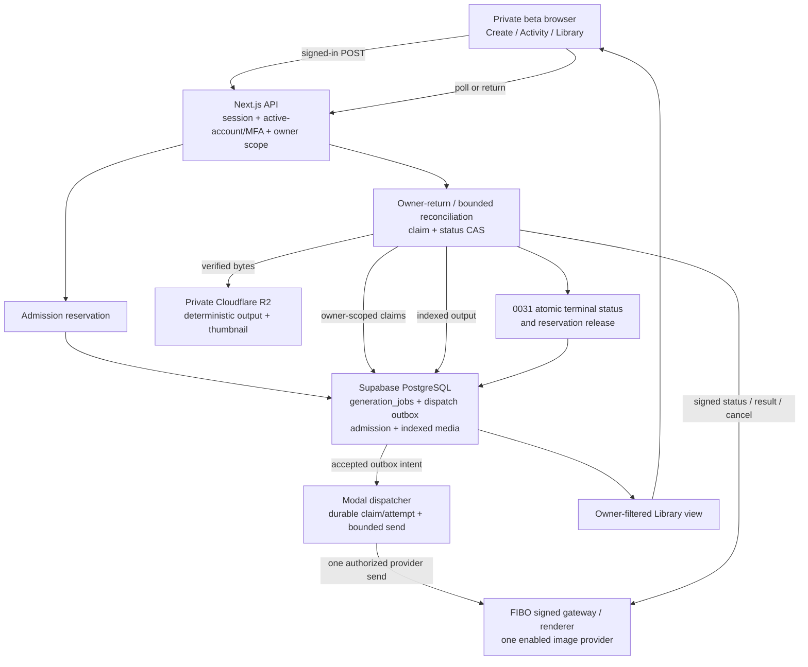
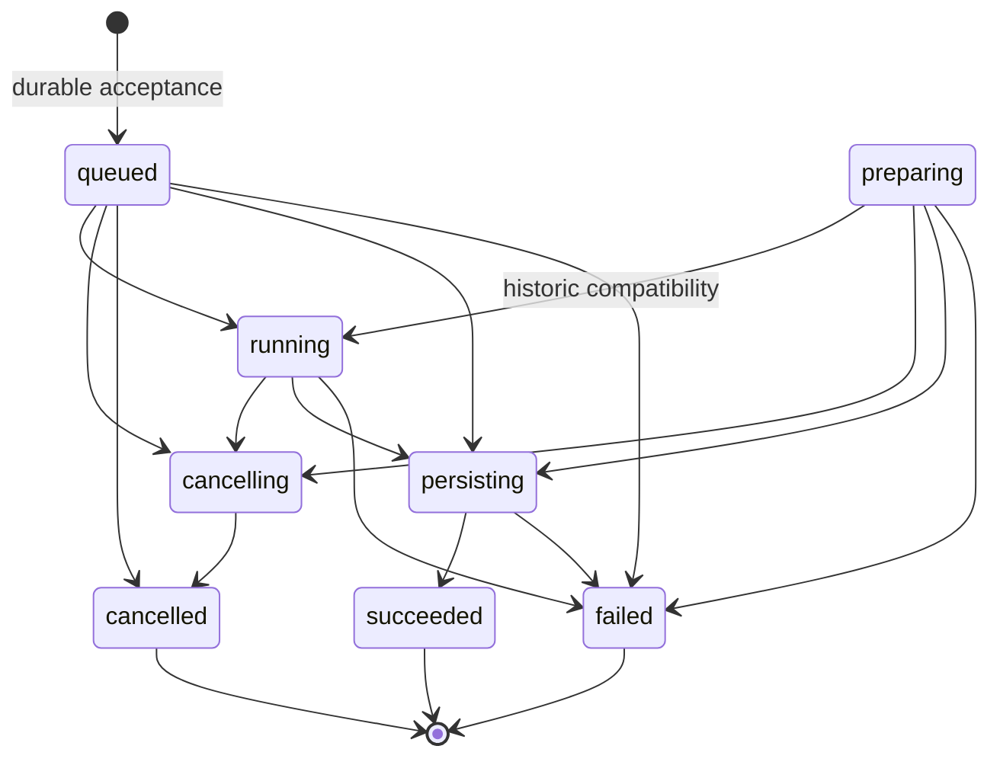

# P1-07 — sanitized evidence pack for independent backend review

**Compiled:** 2026-11-24. **Artifact class:** reviewer handoff, documentation only; **not** a review verdict, release, deployment or new hosted verification. **Source anchor:** [protected `main` at `e28b4192`](https://github.com/faresmohamed260/renderlab/commit/e28b41922728e1052f9021b36bef67a84684f979). **Separately deployed app:** [canonical production record](../production/current.json) says `b548fe40ac274bb4d5bc6d2674ce7bfac556bfcf`; merged `main` is newer and must not be called production. See the [truthfulness claims sheet](P1_07_TRUTHFULNESS_CLAIMS_SHEET_2026-11-24.md).

**Scope and hygiene:** references are public repository paths and controlled GitHub Actions/PR evidence, not copies of production tables, Auth identities, prompts, media bytes, signed URLs, worker credentials, private storage keys, service-account details or user identifiers. The trace below uses neutral role labels and **no live owner/job/call IDs**. Do not attach live screenshots, raw SQL query results, application dumps, artifacts containing user data or provider payloads to a public review.

## 1. Architecture and trust boundaries

The Next.js server holds service-only privilege; the browser never receives it. The `service_role` bypasses RLS, so **explicit owner predicates and verified account status are still mandatory**. SQL outbox and restricted Modal worker/dispatcher roles have different responsibilities; the outbox is the *only* live submission path, not an invitation for an adapter to issue a second POST. The worker does not own owner identity, admission, media indexing or finalization. **Durable dispatch without a browser does not imply always-on job finalization**: the beta still relies on owner return, not a general never-return scheduler.

Primary entry points: [jobs API](../../src/app/api/generation/jobs/route.ts), [generation submit](../../src/server/generation/submit-generation.ts), [admission](../../src/server/generation/generation-admission.ts), [durable acceptance and poll lifecycle](../../src/server/generation/native-generation-lifecycle.ts), [worker fleet/signature](../../src/server/generation/worker-fleet.ts), [reconciliation](../../src/server/generation/reconcile-generation.ts), [owner return](../../src/server/generation/owner-generation-settlement.ts), [cancellation](../../src/server/generation/cancel-generation.ts), [output persistence](../../src/server/generation/native-generation-output-persistence.ts), [atomic terminalization adapter](../../src/server/generation/atomic-terminalization.ts), [0030 SQL outbox](../../supabase/migrations/0030_modal_generation_dispatch_outbox.sql), [0031 SQL function](../../supabase/migrations/0031_atomic_generation_terminalize_release.sql). [Architecture overview](../architecture/BACKEND_ARCHITECTURE_OVERVIEW.md) and [Phase 4 contract](../architecture/BACKEND_P1_PHASE4_CONTRACT.md) are context, not substitutes for those implementations.

## 2. Explicit job state and independent outbox state

`preparing` is a retained compatibility state, **not** a new live FIBO entry state. Idempotent same-state *observation* is omitted from the arrows; it is not permission to perform another SQL write. The outbox has a **separate** seven-state model (`pending`, `claimed`, `retry_wait`, `dispatched`, `unresolved`, `failed`, `cancelled`); a dispatch `retry_wait` is not a job `running` transition. Source: [pure state policy](../../src/lib/capabilities/generation-job-state-machine.ts), [state inventory and remaining exceptions](../architecture/P0_04_GENERATION_STATE_MACHINE_SPEC.md), [outbox SQL](../../supabase/migrations/0030_modal_generation_dispatch_outbox.sql), [dispatch recovery](../../supabase/migrations/20261120022122_modal_dispatch_recovery.sql).

**Proof limit:** the 64-pair pure policy and 24 terminal-RPC edge tests do **not** establish globally enforced SQL transitions. The status `CHECK` constrains values; generic SQL can still cross a forbidden edge (`P0_07_GENERIC_UPDATE`) and unconverted terminal writers can leave a held reservation (`P0_07_NONATOMIC_RELEASE`). The conversion in migration 0031 is *atomic for callers that invoke it*, not a universal SQL trigger. [Disposable database gate](../operations/DATABASE_CONFORMANCE_GATE.md) explicitly tests and names these gaps.

## 3. One representative end-to-end job: independently reproducible trace

This is a **sanitized logical trace** of the [offline critical-path harness](../../tests/unit/generation-critical-path-offline.test.mjs) backed by [network/I/O test doubles](../../tests/helpers/generation-critical-path-runtime.mjs). It illustrates *real application modules with synthetic state*, not a recording of a customer's job. Reproduce with `node tests/helpers/verify-generation-critical-path-determinism.mjs`. A historical checkpoint recorded **20 independent processes, each 23/23 tests and a stable event signature** in the [Unit 5 map](P0_05_DETERMINISTIC_CRITICAL_PATH_TEST_MAP_2026-11-23.md); later added cases must be read from the actual current test runner, not inferred from that old count.

| Step / ordering | Actual code / durable boundary | Offline assertion and interpretation |
| --- | --- | --- |
| 1. Owner-authenticated API request | [POST jobs route](../../src/app/api/generation/jobs/route.ts) → [submit](../../src/server/generation/submit-generation.ts) | Synthetic admitted account; rejected admission yields 429 without a job, outbox or provider call |
| 2. One bounded slot reservation | [generation admission](../../src/server/generation/generation-admission.ts); [0012 SQL](../../supabase/migrations/0012_renderlab_generation_admission.sql) | Reservation precedes a durable job; a denied request cannot spend a provider call |
| 3. One job plus outbox intent | [`submitNativeGeneration`](../../src/server/generation/native-generation-lifecycle.ts) → [`renderlab_accept_generation_dispatch`](../../supabase/migrations/0030_modal_generation_dispatch_outbox.sql) | HTTP **202**, `queued` job, `pending` outbox, stable attempt; **not** a provider image result |
| 4. Browser-independent handoff | [worker transport/wake](../../src/server/generation/native-generation-worker-transport.ts), [outbox/worker SQL](../../supabase/migrations/0030_modal_generation_dispatch_outbox.sql), [recovery](../../supabase/migrations/20261120022122_modal_dispatch_recovery.sql) | Wake leads to **one** dispatcher fixture acceptance; response-lost and ambiguous-send cases do not authorize blind second submit |
| 5. Owner return, serialized poll | [owner settlement](../../src/server/generation/owner-generation-settlement.ts) → [reconcile](../../src/server/generation/reconcile-generation.ts) → [native lifecycle](../../src/server/generation/native-generation-lifecycle.ts) | Synthetic signed provider GET can be `202` pending, retryable `503`, terminal `422`, process-exit `409`, or ready PNG; claim/CAS fences races |
| 6. Persist a ready result | [output persistence](../../src/server/generation/native-generation-output-persistence.ts), [media service](../../src/server/media/media-assets.ts), [R2 storage](../../src/server/storage/r2.ts) | Synthetic PNG gets deterministic primary and thumbnail objects plus **one** indexed media asset; recovery after an R2 interruption does not request a new generation |
| 7. Terminalize and release | [atomic adapter](../../src/server/generation/atomic-terminalization.ts), [0031 SQL](../../supabase/migrations/0031_atomic_generation_terminalize_release.sql) | `persisting → succeeded`; **one** atomic terminal+admission release in the fixture; replay leaves terminal job, indexed asset and reservation unchanged |
| 8. Read the Library again | [owner settlement](../../src/server/generation/owner-generation-settlement.ts), [owner media](../../src/server/media/media-assets.ts) | Second visit/duplicate callback does not create another indexed asset or release reservation twice |

**Separate hosted production witness, not the synthetic trace:** [manual smoke run #45259301091](https://github.com/faresmohamed260/renderlab/actions/runs/45259301091), on the then-verified live application SHA `b548fe40…`, observed **202 → succeeded, exactly one indexed Library asset, one new atomic RPC call recorded by SQL statement statistics, one released reservation, unchanged second Library visit, and independent zero fixture residue**. [Release audit](PHASE3_P007_ATOMIC_PRODUCTION_SMOKE_VERIFICATION_2026-11-23.md), [Phase 3 closeout](PHASE3_BACKEND_P0_CLOSEOUT_2026-11-23.md). One sample does **not** prove all error paths, global exactly-once execution, full SQL transition enforcement or provider-safe double-submit under every distributed failure.

## 4. Migration provenance and grant review

**Do not confuse checked-in migrations, local disposable application, and live hosted application.** Repository inventory at source anchor contains numbered `0001`–`0033` plus three dated dispatch migrations. The [infrastructure authority](../architecture/INFRASTRUCTURE.md#applied-renderlab-migrations) documents historical hosted applications of **`0001`–`0029`** (details/versions per migration there); these are historical recorded assertions, **not a fresh privilege query on 2026-11-24**. The [disposable runner](../../scripts/verify-database-conformance.mjs) replays *checked-in* files into a private PostgreSQL 17 test instance; it never proves a hosted migration was applied.

| Migration / group | Hosted evidence at packet compilation | Privilege and behavior relevant to reviewer |
| --- | --- | --- |
| `0001`–`0009`: sources, jobs, media, ownership, collections, deletion | Listed as applied in [infrastructure history](../architecture/INFRASTRUCTURE.md) | Owner columns/RLS/immutable links, private raw tables and cross-owner media links. Review older defaults and every service-role bypass |
| `0010`–`0019`: account admission, admin, generation admission/reconciliation, cancellation, sessions | Listed as applied in [infrastructure history](../architecture/INFRASTRUCTURE.md) | Explicit owner-scoped RPCs; service-only admission, cancellation claims; `0019` session projection denies browser execute |
| `0020`–`0029`: account lifecycle, profiles, preferences, upload admission, diagnostics/grant tightening | Listed as applied in [infrastructure history](../architecture/INFRASTRUCTURE.md) | Browser-table grants revoked, `0029` diagnostics narrowed to `SELECT/INSERT`, alerts `SELECT`, mutations via restricted SECURITY DEFINER RPCs |
| [`0030` outbox](../../supabase/migrations/0030_modal_generation_dispatch_outbox.sql) | **Applied**, hosted version `20261119230644` per infrastructure authority | Outbox private; `service_role` gets application RPCs, restricted dispatcher gets claim/finish/lookup, restricted worker gets begin-attempt only; no browser execute |
| [`20261120022122` dispatch recovery](../../supabase/migrations/20261120022122_modal_dispatch_recovery.sql) | **Applied**, hosted version `20261120050006` per infrastructure authority | Ambiguous accepted sends preserve lookup/recovery and restricted actor identities; no implied safe duplicate submit |
| [`20261120110000` heartbeat](../../supabase/migrations/20261120110000_generation_dispatch_heartbeat.sql) and [`20261120154000` alert resolution](../../supabase/migrations/20261120154000_generation_dispatch_alert_resolution.sql) | **Applied** as recorded: heartbeat hosted `20261120110737`; alert resolution `20261120155628` | Restricted dispatcher heartbeat; service-only alert resolution. Timestamped filename and hosted version may differ |
| [`0031` terminal+release](../../supabase/migrations/0031_atomic_generation_terminalize_release.sql) | **Applied**, hosted version **`20261123193049`**, grant/function read-back in [rollout audit](PHASE3_P007_ATOMIC_PRODUCTION_SMOKE_VERIFICATION_2026-11-23.md) | SECURITY DEFINER, empty `search_path`, owner-scoped CAS; EXECUTE revoked from `PUBLIC`, `anon`, `authenticated`; granted only to `service_role` (plus owning role); atomically releases bound admission on converted path |
| [`0032` confirmed-email invitation](../../supabase/migrations/0032_verified_email_invitation_claim.sql) | **Checked in; no verified hosted apply** in examined evidence | Migration declares SECURITY DEFINER, empty `search_path`, revoke browser EXECUTE and grant `service_role`; merged source is **not** a live grant read-back |
| [`0033` reconciliation fairness](../../supabase/migrations/0033_generation_reconciliation_fairness.sql) | **Checked in; no verified hosted apply** in examined evidence | Adds `last_reconciled_at` and index; function declares SECURITY DEFINER, empty `search_path`, browser EXECUTE revoke, `service_role` EXECUTE; must precede qualifying its dependent runtime rollout |

**Grant checklist to challenge independently:** current effective `has_table_privilege`/`has_function_privilege` results for `anon`, `authenticated`, `service_role`, the `renderlab_modal_dispatcher` and `renderlab_modal_worker` roles; actual `pg_proc.prosecdef`/`proconfig`, owner, default `PUBLIC` privileges and search-path resolution; RLS and cross-owner denial; neither Modal actor can call the other actor's RPC. Source-level [0030 grants](../../supabase/migrations/0030_modal_generation_dispatch_outbox.sql), [0031 grant tail](../../supabase/migrations/0031_atomic_generation_terminalize_release.sql), [DB conformance](../operations/DATABASE_CONFORMANCE_GATE.md) are the inspectable starting point, **not an attestation of every current hosted privilege**.

## 5. API contract, corpus and OpenAPI

- [OpenAPI 3.1 JSON](../api/openapi.v1.json): generated `3.1.0`, JSON Schema draft 2020-12, private API version `1.0.0`. This describes **invite-only FIBO image** and does not publish an unrestricted API or enable video/audio.
- [Compatibility snapshot](../api/generation-compatibility.v1.json): model `fibo2-edit-turbo`, image-only requests, six supported aspect ratios, maximum 4 inputs, eight job status values, documented error/status surface and six routes.
- [Runtime fingerprint ledger](../api/generation-runtime-fingerprints.v1.json), [source generator/drift checker](../../scripts/generate-generation-api-contract.mjs), [shared runtime parser](../../src/lib/api/generation-contract.ts), [route handlers](../../src/app/api/generation/jobs/route.ts).
- [1,128-case frozen corpus](../../tests/helpers/generation-contract-corpus.mjs), [characterization](../../tests/unit/generation-contract-corpus.test.mjs), [legacy-vs-current differential](../../tests/unit/generation-contract-differential.test.mjs), [API compatibility test](../../tests/unit/generation-api-compatibility.test.mjs). Differential checks acceptance, normalized values, error code **and error message** across the recorded corpus.
- [PR #562](https://github.com/faresmohamed260/renderlab/pull/562) captured the parser baseline; [PR #564](https://github.com/faresmohamed260/renderlab/pull/564) generated the documented OpenAPI. Passing corpus/drift checks **does not** prove unmodeled API behavior, external authorization or a separate hosted pen test.

## 6. Provider adapter and critical-path conformance

| Evidence | What it establishes | What it cannot establish |
| --- | --- | --- |
| [Adapter boundary](../architecture/PROVIDER_ADAPTER_BOUNDARY.md), [typed operation/registry](../../src/server/generation/adapters/provider-adapter.ts) and [FIBO transitional facade](../../src/server/generation/adapters/fibo-adapter.ts) | Explicit operation capabilities, validation, sanitized errors and opt-in registry; existing facade originally delegated the **whole** lifecycle and must not be used to submit again | Merely registering a provider does not enable it; the legacy facade is not a provider-only path |
| [Fake-second-provider shared conformance](../../tests/unit/provider-adapter-conformance.test.mjs), [fake utility adapter](../../tests/helpers/fake-provider-adapter.mjs) | Deterministic fake-clock, input role/output/mask, registry selection, submit/pending/ready/cancel, sanitized errors and no network in tests | This fake adapter is **not** a new production model |
| [Worker transport characterization](../../tests/unit/native-generation-worker-transport-characterization.test.mjs), [critical path replay](../../tests/unit/generation-critical-path-offline.test.mjs) | FIBO payload, signed handle/status, error and sidecar behavior plus admission/claim/media/release order through actual app modules and faked I/O | Not live Modal execution, not real SQL isolation |
| [#626](https://github.com/faresmohamed260/renderlab/pull/626), [#627](https://github.com/faresmohamed260/renderlab/pull/627), [#630](https://github.com/faresmohamed260/renderlab/pull/630) | **Open, unmerged P1-02 sequence**: provider-only payload/status/cancel port; then app payload/poll wiring; then cancellation wiring. Each had six exact-head required contexts plus CodeQL green when Worker 3 marked ready. Tests include signed 202/409/410/422/503, ambiguities, one durable accept/no extra submit, cancel and one atomic release | Not in anchored `main`, not production deployed, not requalified after a future Worker-1 rebase. Do not present PR code as current main or live behavior |

No FIBO provider task is authorized by this evidence pack. Provider lifecycle reads, cancellation and the durable dispatcher must be reviewed as independent boundaries; **never dual-submit** to compare adapters. [Phase 4 validation matrix](../architecture/BACKEND_P1_PHASE4_CONTRACT.md#validation-matrix--no-automatic-hosted-spend) distinguishes local, disposable SQL, hosted and release proof.

## 7. CI cost, test gating and limits of the numbers

**Pinned 30-day audit window:** **2026-10-25 00:00 UTC – 2026-11-23 20:34:46 UTC**, measured from [CI workflow cost audit](CI_WORKFLOW_COST_AUDIT_2026-11-23.md) at its historical SHA `50473eb5`. Figures are **runner-equivalent elapsed-minute proxies, not charges or savings**.

| Audit measure | Result | Interpretation / verification caution |
| --- | ---: | --- |
| Current workflow definitions at audit snapshot | **26** | Workflow inventory and trigger classification, not a fresh 2026-11-24 inventory |
| Returned runs across all old/current workflows | **6,349** | 4,631 current-defined workflow runs plus 1,718 historical removed/dynamic runs |
| Current-defined workflow runner-equivalent minutes | **~6,199** | Wall-time proxy; not precise job-level billing |
| Five core workflow families (Engineering Quality, CodeQL, Unit Coverage, Governance, Portability) | **~5,572 (~90%)** | Required contexts run on docs-only PRs as well |
| Developer Portability | **817 runs / ~3,206 equivalent minutes** | Concurrent Windows runner weighted 2× under audit method |
| Cancelled core runs | **656** | Actual wasted vs avoided minutes not measured |
| Sampled public-repository GitHub billed minutes | **0** | Sampling is not an invoice for all jobs; external GPU/Modal, Supabase, R2, Vercel costs not available |
| [#616](https://github.com/faresmohamed260/renderlab/pull/616) optional W4/W4C Markdown-trigger cleanup | **21 historical runs / ~14 eq.min is an absolute whole-workflow bound** | Not an estimate of realized savings; protected checks and production workflows retained |

The audit found **four redundant fresh installs and three builds** on a docs-only PR while required contexts remained needed. [Expected protected check policy](../governance/github-protection.json) lists six: `quality`, `governance`, `unit-coverage`, `javascript-typescript`, `clean-room (ubuntu-latest)`, `clean-room (windows-latest)`; CodeQL is independently checked. Audit read-back of **live branch-protection administration returned 403**, so this pack claims repository policy plus actual CI histories, not independent confirmation of admin-enforced GitHub settings. [P1-04 CI audit](CI_WORKFLOW_COST_AUDIT_2026-11-23.md) is the baseline for any future savings estimate.

## 8. Restore-drill report: existing live recovery vs new 0031-aware simulation

| Evidence type | Proof / result | Important exclusions |
| --- | --- | --- |
| Historical **retained hosted generation** manual restore | [ENT-007 assessment](ENT_007_DESTRUCTIVE_LOSS_RECOVERY_ASSESSMENT.md) and [October 7 run #37630554797](https://github.com/faresmohamed260/renderlab/actions/runs/37630554797): encrypted logical DB/Auth + retained R2 object restored into isolated PostgreSQL 17/run-owned object path; 10 contracted tables, one bounded Auth identity, one object, zero tested owner/reference anomalies, cleanup passed | Not PITR, full-project recovery or sessions/MFA continuity; observed ~5.253 s combined verification is **not** an RTO |
| Latest **documented manual expanded** recovery | [October 17 run #39035575310](https://github.com/faresmohamed260/renderlab/actions/runs/39035575310) per [incident runbook](../operations/INCIDENT_RESPONSE_AND_RECOVERY.md): nine retained objects, **5,873,239 bytes**, nine cross-store references and cleanup passed | This is older than migration 0031, not proof of post-0031 backup compatibility |
| Documented Monday schedule | [Incident runbook](../operations/INCIDENT_RESPONSE_AND_RECOVERY.md) names five successful weekly exercises through **November 16** ([Nov 16 run #43907929100](https://github.com/faresmohamed260/renderlab/actions/runs/43907929100)); the [30-day CI audit](CI_WORKFLOW_COST_AUDIT_2026-11-23.md) records five recovery-drill runs with **20% failure** in its distinct window | Different report windows/counting; no independent Nov 23/24 schedule read-back was conducted for this docs pack. Do **not** promote last-documented run to latest-live status |
| **0031-aware local disposable version-skew** | Merged [#615](https://github.com/faresmohamed260/renderlab/pull/615), head `702387bb`, 6 required checks, CodeQL and optional disposable PostgreSQL check all passed. [SQL/version-skew harness](../../scripts/verify-database-conformance.mjs) exercises old-app generic SQL, new-app atomic RPC and rollback-app compatibility with 0031 retained | Explicitly demonstrates generic SQL gap; not a shared Supabase or real restored-backup operation |
| **0031-aware synthetic ENT-007-format restore** | Merged [#617](https://github.com/faresmohamed260/renderlab/pull/617), head `10549339`, 6 required checks, CodeQL and disposable PostgreSQL check passed. [Synthetic restore verifier](../../scripts/verify-0031-ent007-isolated-restore.mjs) creates test-only encrypted snapshot, restores to a second local PG17 database, tests owner/Auth omissions, retained media bytes, one atomic success+release and idempotent replay, and verifies **zero fixture residue** | No real retained generation, no hosted Supabase, no Cloudflare R2 download, no restored sessions/MFA and no disaster failover. Do **not** call it a production restore drill |

**Required independent challenge:** reproduce the synthetic 0031 post-restore case; check schema and grant drift against a *genuinely retained* backup under authorized isolated scope, if separately approved; quantify successful scheduled restoration and restore-object retention; test rollback with 0031 left installed. **Do not run a hosted restore or spend provider resources solely to prepare/review this docs pack.** [Recovery runbook](../operations/INCIDENT_RESPONSE_AND_RECOVERY.md) is operator guidance, not proof that recovery will always work.

## 9. Exact production release manifest, workflow proof and rollback

- [Canonical manifest](../production/current.json): deployed application SHA **`b548fe40ac274bb4d5bc6d2674ce7bfac556bfcf`**, deployment ID **`dpl_2J4BXM3Y4xF9JWo1cdj38Da5CWJR`**, cutover **2026-11-23T20:00:50.248Z**; rollback SHA **`696ca784759eb94457005381fc34b0509d00e920`**, deployment **`dpl_DPm2p2XMTiR7GrMasYPbeAYkvMhJ`**. IDs here are **deployment IDs**, not user/job/account IDs.
- [Readiness #45252066830](https://github.com/faresmohamed260/renderlab/actions/runs/45252066830) and six required exact-source check-run IDs are in the manifest; last required completion **19:45:57Z**, before alias cutover. Readiness itself is separate from CodeQL scope.
- [One-generation production smoke #45259301091](https://github.com/faresmohamed260/renderlab/actions/runs/45259301091) passed with verified cleanup; fixture authorization from that release is **spent**, not available for this review. [Detailed dated release audit](PHASE3_P007_ATOMIC_PRODUCTION_SMOKE_VERIFICATION_2026-11-23.md).
- [Final Production Documentation Sync #45260819016](https://github.com/faresmohamed260/renderlab/actions/runs/45260819016) **SUCCESS**, cited in the [Phase 3 closeout](PHASE3_BACKEND_P0_CLOSEOUT_2026-11-23.md). This proves that recorded release checkpoint, **not a hypothetical post-P1 deployment**.
- [Release runbook](../operations/PRODUCTION_RELEASE_RUNBOOK.md) requires exact-head build/health and independent live alias read-back, same-sitting manifest + five mirrors + synchronization, rollback anchor and a separately authorized bounded fixture. Current source/PRs must not be described as released without a **new** signed-off release record.

## 10. Explicit gaps and active dependencies

The [truthfulness sheet](P1_07_TRUTHFULNESS_CLAIMS_SHEET_2026-11-24.md) is the reviewer's compact evidence/overclaim crosswalk. **Unresolved is not waived**:

1. Scoped 0031 atomicity is not universal SQL state-transition enforcement; legacy/dispatch paths remain review targets.
2. Owner-return finalization is not continuous and lacks a never-return scheduler; provider retention remains a dependency.
3. New P1-02 provider port and wiring are **unmerged** [#626](https://github.com/faresmohamed260/renderlab/pull/626) → [#627](https://github.com/faresmohamed260/renderlab/pull/627) → [#630](https://github.com/faresmohamed260/renderlab/pull/630), all requiring Worker-1 rebase/merge and separately qualified app release.
4. R8 idempotency [PR #628](https://github.com/faresmohamed260/renderlab/pull/628) is **open**, so an implementation of the final protocol cannot be assumed deployed; runtime trust work [#603](https://github.com/faresmohamed260/renderlab/pull/603) and TLS canary [#625](https://github.com/faresmohamed260/renderlab/pull/625) are also open at this source checkpoint.
5. P1-03 observability [#629](https://github.com/faresmohamed260/renderlab/pull/629) is **open**; data/labels/alert thresholds are not proven live. CI savings are proxies, not invoices.
6. Source migration 0032/0033 and their grants lack a confirmed hosted-apply read-back in examined records; a repo file is not production state.
7. CI branch protection live admin settings were not readable; test proofs and workflow-defined required checks are not a replacement for admin policy audit.
8. A final **independent external** reviewer and dated severity-ranked findings + **owner disposition** are **not yet on file**. The [Nov 23 three-reviewer interim ledger](EXTERNAL_REVIEW_2026-11-23.md) is useful background, **not** this exit gate.
9. The 0031-aware restore is synthetic, not a fresh retained hosted backup restore; Free logical backups have no PITR, full-project, session/MFA or published RPO/RTO guarantee.
10. Latest [technical claims authority](../TECHNICAL_CLAIMS.md) is a dated portfolio-facing sheet and may carry stale historical file paths/coverage numbers. Reviewer should check the implementation, not inherit its date as fresh validation.

## 11. What we want challenged — reviewer assignment

- **Concurrency/duplicate spend:** Can any ambiguous dispatcher response or adapter path create a second provider call for one durable attempt? Can stale claims/outbox retries double-charge despite one indexed result?
- **Atomicity/transition loopholes:** Which remaining writer can fail or cancel terminally and leave a held slot, overwrite terminal state or bypass 0031? Reproduce using real concurrent Postgres sessions.
- **Ownership and effective grants:** Can a `service_role` route omit owner filters, or can browser/Modal principals invoke a privileged RPC via default grants, search-path or definer ownership?
- **Provider failure semantics:** Recheck 202/409/410/422/503, timeout, cancellation, sidecar and ambiguous observations: do redacted errors hide useful state or accidentally release a reservation?
- **Resilience/restore:** Do old/new/rollback app versions and a genuinely retained backup remain compatible with 0031, and what loss window or security state cannot be restored?
- **Scope claims:** Do the API corpus and OpenAPI cover real effective authorization and new operations? Are FIBO-only, disabled provider, and never-return limitations stated prominently enough?
- **Operations/cost:** Which metrics and alert signals would catch held-terminal slots, idle backlogs, dead dispatchers, runaway retries and GPU usage before real harm? Are CI “minutes” confused with actual billed spend?
- **Release reproducibility:** Can an outsider reconstruct the exact deployed SHA, protected-check qualification, rollback target, one fixture result and zero-residue cleanup without private credentials or accepting engineer assertions?

**Review acceptance requirement:** an engineer **outside the implementation worker team** should date/sign a written assessment, provide a reproducible sanitized test matrix, assign severity/risk to findings and give source/test links; the product owner then records **fixed / explicitly accepted with rationale / deferred with trigger**. Critical correctness/security issues cannot silently pass the charter gate. This pack's authors are **not** that independent reviewer. Nothing here authorizes merging, applying a migration, running a provider generation, changing live systems or opening frontend/new-provider work.
